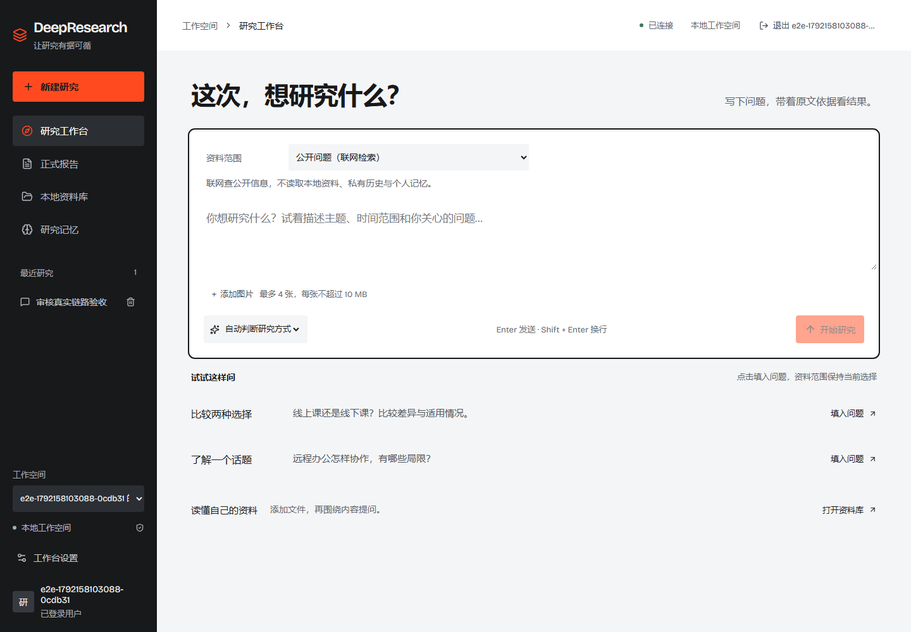
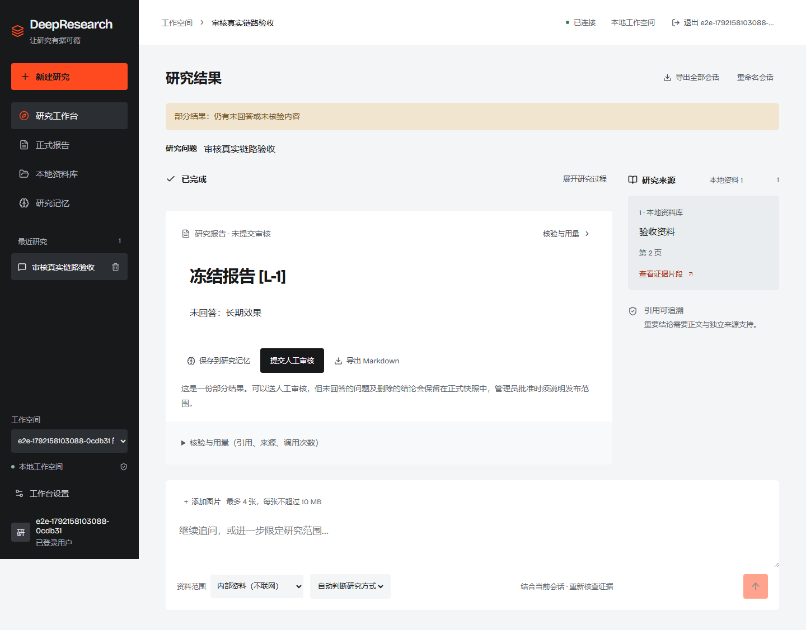
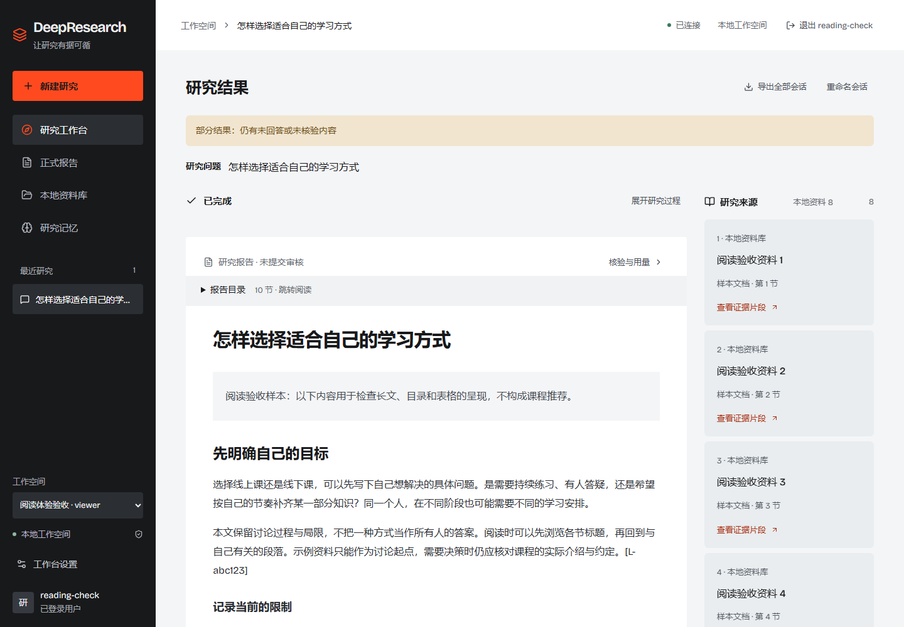
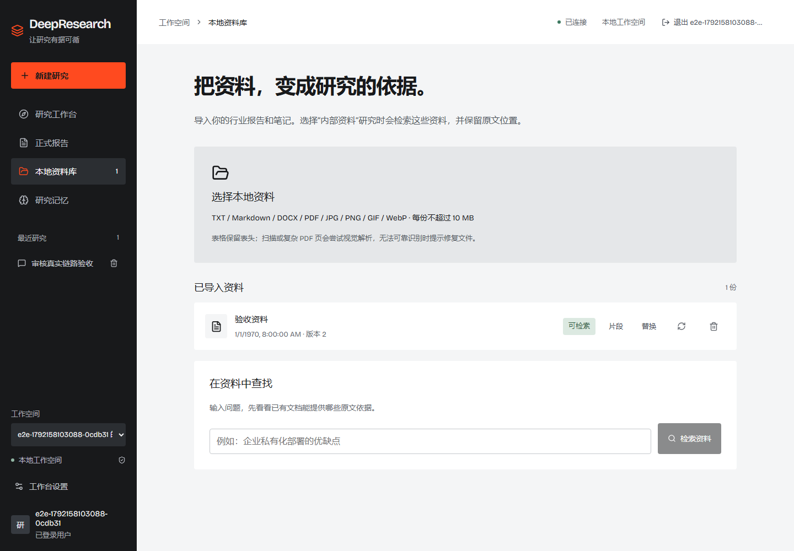
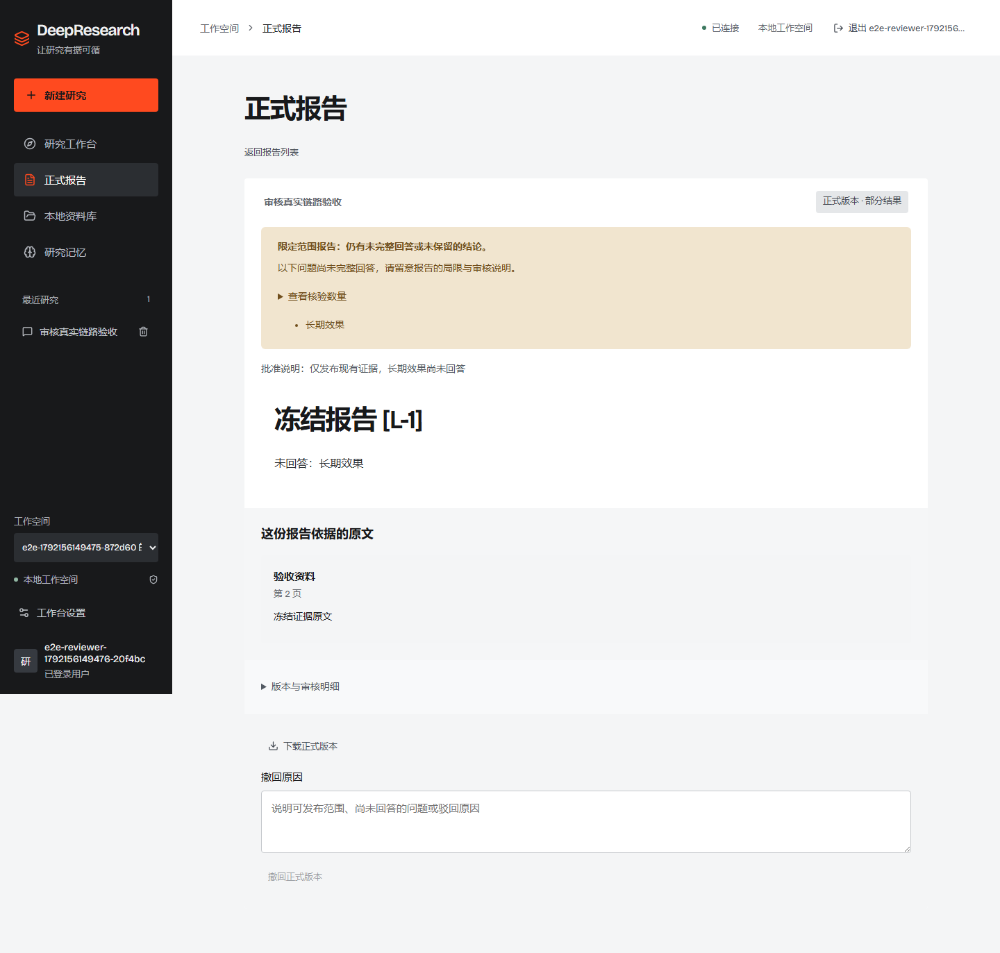
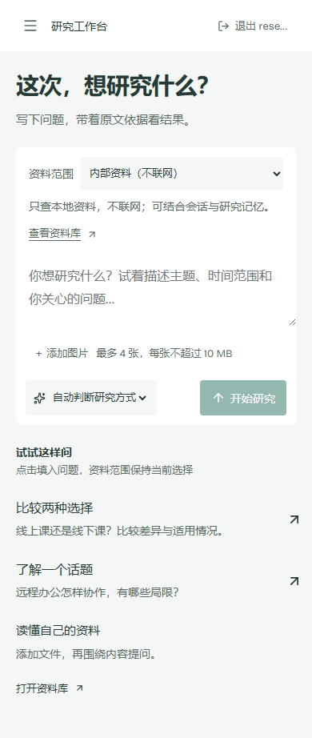

# DeepResearch 企业研究工作台

输入研究问题，从公开网页或本地资料中查找依据，生成带引用的中文报告，并可交由另一位管理员审核、发布正式版本。

基于 **Spring Boot + LangGraph + Vue 3**，适合资料问答、方案比较、专题调研和团队内部试用。支持 Docker Compose 单机部署，模型与搜索服务需自行配置。

[快速部署](#快速部署) · [开始使用](#开始使用) · [效果图](#效果图) · [常见问题](#常见问题) · [更多文档](#更多文档)

## 解决什么问题

| 常见困扰 | DeepResearch 的处理方式 |
| --- | --- |
| 网页和文件分散，整理资料耗时 | 围绕问题规划检索、分析资料并组织报告 |
| AI 回答缺少依据，难以核实 | 展示引用、原文片段和资料位置，保留证据不足提示 |
| 内部资料与公开搜索容易混用 | 显式选择资料范围，服务端限制检索与模型处理 |
| 研究结果需要复核和交付 | 支持异人审核，冻结正式报告的正文与证据 |

## 主要功能

- **研究与追问**：自动判断、快速问答、深度研究；查看任务进度、停止任务，并在同一会话继续提问。
- **本地资料库**：上传 TXT、Markdown、DOCX、PDF 和图片，扫描后建立检索索引；单份文件不超过 10 MB。
- **引用与原文**：从报告查看来源及证据片段，导出 Markdown；未回答的问题和部分结果会明确标注。
- **图片输入**：每次最多添加 4 张图片，用于看图问答或辅助研究。
- **团队协作**：账号登录、工作空间成员管理、研究员与只读角色、人工审核和正式报告下载。
- **运行管理**：任务检查点恢复、个人研究偏好，以及 Grafana 指标、日志和追踪。

## 快速部署

### 1. 准备环境并获取代码

需要 Git、Docker 和 Docker Compose。Windows 用户先启动 Docker Desktop，并使用 Linux 容器。以下命令使用 PowerShell，在项目根目录执行；Docker 会构建应用，无需另装 Java、Python 或 Node.js。

```powershell
git clone https://github.com/W205614/DeepResearch.git
cd DeepResearch
Copy-Item .env.example .env
```

已有部署请先备份，再参考[升级与维护记录](docs/local-pilot-operations.md)，不要覆盖现有 `.env`。

### 2. 配置密钥和服务密码

用编辑器打开 `.env`，填写下列配置。首次建议使用至少 16 位的随机字母数字密码，避免数据库连接串中的特殊字符转义问题；不要提交 `.env`。

| 配置项 | 如何填写 |
| --- | --- |
| `LLM_API_KEY` | 对话模型密钥；核对同组的 `LLM_BASE_URL`、`LLM_MODEL_ID` 是否与供应商一致 |
| `EMBEDDING_API_KEY` | 嵌入模型密钥；同时填写 `EMBEDDING_BASE_URL`、`EMBEDDING_MODEL` 和实际输出的 `EMBEDDING_DIMENSION` |
| `POSTGRES_PASSWORD` | 项目数据库密码 |
| `KEYCLOAK_DB_PASSWORD` | 身份服务数据库密码 |
| `KEYCLOAK_ADMIN_PASSWORD` | Keycloak 管理台 `admin` 账号的初始密码 |
| `MINIO_ROOT_PASSWORD` | 文件存储服务密码 |
| `GRAFANA_ADMIN_PASSWORD` | Grafana `admin` 账号的初始密码 |

**首次体验还需留意：**

- 模板的 `WEB_SEARCH_PROVIDER=deepseek` 会复用模型密钥，调用该端点的 Responses `web_search` 工具。若端点不支持，可改为 `bocha` 并填写 `BOCHA_API_KEY`；仅兼容聊天接口不足以提供联网搜索。
- 嵌入服务地址需按实际供应商填写，模板地址只是预置值。即使先体验公开研究，也请填写嵌入密钥。
- 图片功能需要 `VISION_MODEL_ID` 对应的视觉模型可用，它复用 `LLM_BASE_URL` 和 `LLM_API_KEY`。首次可先使用纯文字问题。
- 重排是可选能力：填写 `RERANKER_API_KEY`，或先设置 `RERANKER_ENABLED=false`，使用关键词与向量融合检索。

模型、嵌入、搜索和可选重排可能产生供应商费用；其余调优参数可先保留模板默认值。

### 3. 启动服务

```powershell
docker compose up -d --build --wait --wait-timeout 300
```

首次需要下载镜像、构建应用并初始化资料扫描服务，耗时取决于网络和机器资源。Compose 会自动执行数据库迁移并启动依赖服务。

| 入口 | 地址 | 登录方式 |
| --- | --- | --- |
| 研究工作台 | [localhost:8080](http://localhost:8080) | 点击“创建本地账号”，注册后使用 |
| Keycloak 管理台 | [localhost:8180/admin](http://localhost:8180/admin) | `admin` / `KEYCLOAK_ADMIN_PASSWORD` |
| Grafana 监控 | [localhost:3000](http://localhost:3000) | `admin` / `GRAFANA_ADMIN_PASSWORD` |

普通用户只需访问研究工作台。默认入口仅供本机访问；首次部署建议保留默认端口，避免额外配置登录回调。

## 开始使用

### 先完成一条公开研究

1. 打开 [研究工作台](http://localhost:8080)，点击“创建本地账号”。注册后返回工作台；已有账号选择“登录并开始研究”。首次登录会创建个人工作空间。
2. 将输入框上方的资料范围切换为 **“公开问题（联网检索）”**。页面默认是内部资料范围，首次体验请主动切换。
3. 输入问题，例如：**“比较线上课程与线下课程的差异、适用人群与局限，请给出公开来源。”**
4. 选择“深度研究”，点击“开始研究”，等待报告；可展开研究过程查看进度。
5. 点击报告引用或“查看证据片段”回查原文；需要保存时选择“导出 Markdown”。证据不足时，结果可能只回答部分问题。

公开模式不读取本地资料、私有会话历史和个人记忆；追问时请明确写出需要沿用的背景。

### 再使用自己的资料

1. 先确认允许所配置的模型、视觉和嵌入供应商处理这些资料，再在 `.env` 设置 `ALLOW_INTERNAL_MODEL_PROCESSING=true`，重新执行上面的启动命令使配置生效。
2. 打开左侧“本地资料库”，上传一份文件，等待扫描和索引完成，状态变为 `ready`。
3. 新建研究，选择 **“内部资料（不联网）”**，围绕文件内容提问，例如“根据这份资料，总结方案的优势、限制和适用条件”。

内部资料处理默认关闭；“不联网”指不进行公开网页搜索，模型、嵌入和可选重排仍可能调用所配置的外部服务。仅在确认供应商与资料使用范围后开启。

<details>
<summary>需要发布正式报告时</summary>

1. 另一位用户注册后，在“工作台设置”复制自己的账号 ID。
2. 当前工作空间管理员在“工作台设置 → 工作空间成员”中添加该账号，角色选择“管理员（可审核）”。
3. 研究作者在满足提交条件的报告下点击“提交人工审核”；另一位管理员刷新页面，在左侧切换到受邀的工作空间，再进入“正式报告”审核。
4. 批准后可阅读和下载冻结的正式版本。作者不能审核自己的报告；部分结果批准时必须说明发布范围。

Keycloak 管理台账号与工作空间管理员角色是两套权限；普通研究和导出草稿不需要第二个账号。

</details>

## 效果图

工作台与审核流程截图来自本机部署，研究报告和审核内容使用固定验收资料；长报告为人工编写的阅读样本，用于展示排版。

### 研究工作台

选择资料范围、输入问题、开始研究。



### 报告与原文证据

报告展示引用、来源入口和未完整回答的问题，可继续追问或导出。



<details>
<summary>查看更多：长报告、资料库、审核与手机布局</summary>

长报告阅读样本，可按章节跳转：



本地资料库：



正式报告审核与证据快照：



手机研究工作台：



</details>

## 常见问题

| 问题 | 处理方式 |
| --- | --- |
| 启动失败或超时 | 用 `docker compose ps -a` 查看状态，再用 `docker compose logs --tail 80` 查看错误。先核对 `.env` 必填密码、镜像下载和 Docker 资源；`migrate` 显示 `Exited (0)` 表示迁移成功 |
| 页面能打开，但无法研究 | 查看“工作台设置 → 服务连接”的待配置项。核对模型与嵌入密钥、端点和模型名称，以及搜索端点是否支持所选协议 |
| 提示内部资料模型处理未获准 | 体验公开检索时切换为“公开问题”；需要处理本地资料时，按上面的授权配置步骤操作 |
| 上传后暂时查不到资料 | 等待扫描和索引完成。若为 `scan_failed`，查看 `docker compose logs --tail 80 clamav document-worker`；被隔离的文件不能用于研究 |
| 登录提示 `Invalid parameter: redirect_uri` | 先使用默认 `http://localhost:8080`。如修改了 `APP_PORT`，还需在 Keycloak 的 `deepresearch-web` 客户端配置对应回调地址与 Web Origins |

停止服务并保留数据：

```powershell
docker compose down
```

下次启动使用上面的启动命令。**不要添加 `-v`**，否则会删除包含账号、资料和研究记录的数据卷。

## 更多文档

Java 负责身份权限、工作空间与任务生命周期；Python 负责研究编排、检索与文档处理；Vue 提供工作台。底层使用 PostgreSQL、Redis、Milvus 和 MinIO，默认编排同时包含身份、扫描与监控服务。

- [完整配置模板](.env.example) · [部署编排](compose.yaml)
- [登录与账号说明](docs/local-keycloak-login.md) · [升级、备份与维护记录](docs/local-pilot-operations.md)
- [Java / Python 职责划分](docs/java-python-ownership.md) · [图片与文档解析](docs/multimodal.md)
- [检索评测](eval/benchmark_results.md) · [历史交付记录](docs/delivery-history.md)

当前部署面向单机演示与受控试用。引用和模型核验有助于回查依据，重要结论仍需人工核实；截图与固定题集结果不代表通用回答准确率或生产可用性承诺。
