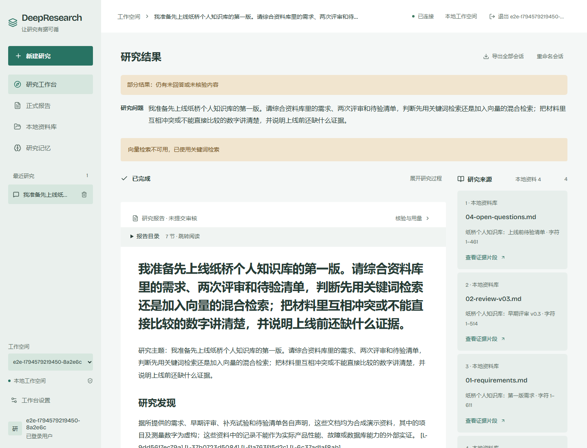
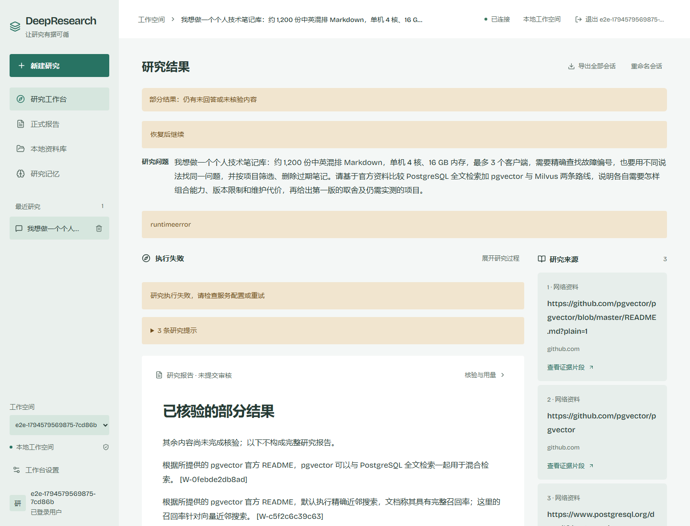
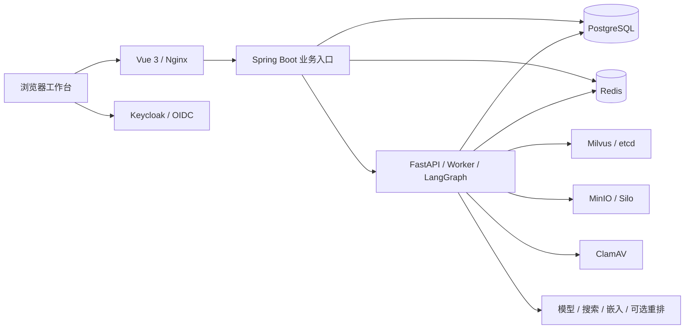

# DeepResearch 研究工作台

把研究问题、检索资料、原文引用和报告审核放在一个工作台中。输入问题后，从公开网页或有权限的内部资料查找依据，生成带引用的中文草稿；读者可以回看原文片段，由另一位管理员审核后发布冻结版本。

适合需要保留依据、反复追问和协作审阅的个人或小团队。Agent 负责规划、检索、分析和写作；身份权限、任务预算、资料授权与正式报告由业务系统管理。模型生成内容仍需人工判断，资料不足会显示部分结果和未回答问题。

正式交付状态、镜像和最终验收以[最新版本页](https://github.com/W205614/DeepResearch/releases/latest)为准。下文带日期的验证段落保留提交时的阶段记录；后续版本不会改写旧失败或旧截图。

- 部署：[v0.1.8 快速上手](#v018-快速上手) · [选择启动方式](#选择启动方式) · [v0.1.8 镜像摘要与部署说明](docs/container-packages.md#v018-启动入口)。
- 理解项目：[架构与目录](#架构与目录) · [源码调用路径](docs/project-structure.md) · [Java／Python 职责](docs/java-python-ownership.md)。
- 维护：[贡献指南](CONTRIBUTING.md) · [升级与恢复](docs/deployment-security-operations.md) · [安全报告](SECURITY.md)。

## v0.1.8 快速上手

以下 PowerShell 示例使用 [v0.1.8](https://github.com/W205614/DeepResearch/releases/tag/v0.1.8) 的三个公开应用镜像和核心服务。准备 Git、Python 3.11.5 至 3.13、uv、Docker Linux/amd64 和 Compose v2。Windows 使用 Docker Desktop 的 Linux 容器。首次安装要联网下载镜像和源码，并编译 Milvus、MinIO 等配套依赖。已有部署请沿用原项目名和覆盖文件，先核对[升级与恢复条件](docs/deployment-security-operations.md#现有数据升级)。

1. 检出发布标签并初始化本机配置。

   ```powershell
   git clone --config core.autocrlf=false --branch v0.1.8 https://github.com/W205614/DeepResearch.git
   cd DeepResearch
   python scripts/local.py init
   ```

2. 在 `.env` 中填写 `LLM_API_KEY` 和 `EMBEDDING_API_KEY`。使用重排时填写 `RERANKER_API_KEY`，否则设置 `RERANKER_ENABLED=false`。初始化会生成其余服务凭据。

3. 在同一 PowerShell 会话逐条执行以下命令。首次启动时 ClamAV 还会下载病毒特征库。

   ```powershell
   $env:DEEPRESEARCH_PACKAGE_VERSION = 'v0.1.8'
   $composeFiles = @('-f', 'compose.yaml', '-f', 'deployment/compose/compose.core.yaml', '-f', 'deployment/compose/compose.packages.yaml')
   python scripts/local.py check --compose-file deployment/compose/compose.packages.yaml
   uv run --frozen --no-dev python scripts/build_minio_alpine_20261121.py
   docker build --platform linux/amd64 -f Dockerfile.milvus -t deepresearch-milvus-legacy:20261122 .
   docker compose --parallel 1 @composeFiles build postgres keycloak-postgres etcd milvus keycloak storage-init clamav
   docker compose @composeFiles pull agent backend web
   docker compose @composeFiles up -d --no-build --wait --wait-timeout 600
   ```

4. 打开 `http://localhost:8080`，注册或登录业务账号，创建个人空间并[发起第一条研究](#启动后的第一条研究)。检查状态用 `docker compose @composeFiles ps`，暂停用 `docker compose @composeFiles stop --timeout 60`，配置和数据卷会保留。

三个应用镜像的固定摘要见 [v0.1.8 发布页](https://github.com/W205614/DeepResearch/releases/tag/v0.1.8)。要从源码重建应用，完成前两步后运行 `uv run --frozen --no-dev python scripts/local.py start`，由启动器准备依赖并构建核心栈。

## 可以做什么

| 场景 | 操作与可观察结果 |
| --- | --- |
| 公开研究 | 输入问题、确认范围，使用快速问答或深度研究；查看进度、正文、来源与原文，导出 Markdown 并继续追问 |
| 内部资料问答 | 上传 TXT、Markdown、DOCX、PDF 或图片，完成扫描、解析和索引；按资料权限检索，撤权同步影响历史访问 |
| 协作审核 | 作者送审，另一位管理员批准；冻结正文和证据，保留修订、驳回、撤回及审计记录 |
| 平台管理 | 管理空间、成员、账号停用与恢复、任务取消、用量和空间交接；旧会话撤销后须重新登录 |

内部资料模式关闭公开搜索，配置的模型服务仍会处理资料。使用前确认数据处理范围，按[资料与报告生命周期](docs/evidence-lifecycle.md)管理授权。单文件上限 10 MB，每轮最多 4 张图片；任务调用与 Token 预算由持久化账本约束。

### 当前研究流程

以下功能可在当前应用镜像中使用。

- 提交前检查所选资料范围的可用性。需要澄清时，可以修改建议的时间、地区、研究对象和交付要求。对已有报告继续追问时，新任务保留原研究的关联。
- 在报告的「答题覆盖」中查看各项状态和证据。对缺口可选择「仅补查此项」，编辑联网查询或提供网页，内部模式也能在新资料完成索引后重查。只有通过核验并能补充所选项的结论才合入草稿，原报告仍可回看。
- 并排核对原文片段，查看网页复查状态，在草稿或获准访问的正式报告中导出决策摘要。草稿的局限和正式版的审核边界继续可见。

### v0.1.7 修复

- 报告会保留已经核验的事实，并明确标记仍未回答的问题。送审和批准会检查完整性标记。
- 会话 Markdown 下载会在写入时复核访问权限。草稿导出注明执行状态和核验质量。
- 后台任务更新不会切换正在阅读的历史报告。研究范围会说明是否搜索公开网页，以及配置的模型和嵌入服务可能处理哪些输入。

## 两个研究示例

### 本地：跨版本资料的方案评估

上传[纸桥案例的四份 Markdown](docs/examples/paperbridge/README.md)，选择“内部资料（不联网）”：

> 我准备先上线纸桥个人知识库的第一版。请综合资料库里的需求、两次评审和待验清单，判断先用关键词检索还是加入向量的混合检索；把材料里互相冲突或不能直接比较的数字讲清楚，并说明上线前还缺什么证据。

这个案例需要对照需求、旧评审、新试验和待验清单：区分文件与文本块、查询样本变化、平均延迟与 P95，再将技术路线建议和上线批准分开。所有输入数字都是合成记录，用来检查证据处理，不能当作项目性能评测。



2026-11-13 在 `v0.1.4` 候选上以 auto 模式完成真实模型复验：26 条结论全部获得支持，0 条删除，原问题回答标记为 true，浏览器用例通过。报告仍保留 `partial`：本次向量检索不可用，使用了关键词检索；资料中的待验项也没有被改写成已通过。[版本验收记录](https://github.com/W205614/DeepResearch/releases/tag/v0.1.4)区分本次通过与此前失败。

### 联网：带运行约束的数据库选型

另开研究，选择“公开问题（联网检索）”：

> 我想做一个个人技术笔记库：约 1,200 份中英混排 Markdown，单机 4 核、16 GB 内存，最多 3 个客户端，需要精确查找故障编号，也要用不同说法找同一问题，并按项目筛选、删除过期笔记。请基于官方资料比较 PostgreSQL 全文检索加 pgvector 与 Milvus 两条路线，说明各自需要怎样组合能力、版本限制和维护代价，再给出第一版的取舍及仍需实测的项目。

这要求核对官方功能、适用版本及能力组合，并保留单机资源、中文检索、删除一致性和维护成本的实测缺口。公开模式不读取前述本地资料；官方功能说明不能替代假设机器上的实际测量。



本次 quick 模式实际获取 3 份官方全文资料，保留已获取的资料和未完成结果；9 次供应商请求均为 HTTP 200。后续验证被本轮累计 25 USD 的额外费用守卫停止，整份报告与 Milvus 路线比较尚未完成验收，画面如实保留失败和部分结果提示。它展示联网检索与证据保留过程，不是完整比较报告的成功样例；旧超时失败记录仍见[历史证据](docs/evidence/followup-20261113/README.md)。

## 界面与验证范围

[正式审核画面](docs/images/report-review.png)、[手机工作台](docs/images/workspace-mobile.png)及[原工作台截图](docs/images/workspace.png)展示其他操作。这些旧截图使用固定资料和合成账号，不是本轮新模型验收；来源见[素材说明](docs/images/README.md)。

[`v0.1.5` 的交付记录](https://github.com/W205614/DeepResearch/releases/tag/v0.1.5)绑定工程与镜像分发提交 `e6799f73b00144b9ef16b71dedac2759a5cf54af`。同提交 CI 的 4 项检查、Security 的 22 项检查及 Packages 发布均成功。三个应用镜像已实际匿名完整拉取，核对 manifest、config、各层及实际 Docker 拉取身份。29 份公开附件完整下载核验通过。

2026-11-16 本机日常环境更新 21 个角色、保留另 4 个角色的身份与配置；整套启动、只读健康与权限检查、5 个运行角色的源码指纹核对通过。14 张业务表共 572 行的逐行摘要一致，16 个卷及 9 个网络引用保持，验收后 25 个容器全部停止。此范围不代替异机恢复、生产高可用或完整第三方基础栈二进制分发验收。

本版真实本地资料案例回答原问题，实际 Milvus 检索得到 16 个有效候选，28 条结论获得支持、1 条移除，报告仍为 `partial`。真实联网 quick 案例正常完成，保留 `original_request_answered=false`：9 条支持、2 条移除、2 个官方来源；页面明确展示 6 个网页读取失败、资料缺口和未回答问题，只读页面核验通过。未完整覆盖不自动表示执行失败；本轮没有实测深度补搜路径，也不将该案例称为完整比较。上方两张图片继续保留 `v0.1.4` 的历史结果。

本轮新增 46 次供应商请求均为 HTTP 200，保守费用上界为 **1.374595 USD / 25 USD**；包含未完整答题的测试费用，不是实际账单。历史 169 次请求与 24.694389 USD 保留，账本累计 215 次，不重置旧预留。

[`v0.1.3` 的拉取与日常验收](https://github.com/W205614/DeepResearch/releases/tag/v0.1.3)、[首次真实流程检查](docs/evidence/release-20261112/README.md)和[此前候选失败](docs/evidence/followup-20261113/README.md)保留各自时间与范围。恢复与组件负载证据见[2026-11-08 验收](docs/evidence/daily-20261108/README.md)及[证据索引](docs/evidence/production-20261107/README.md)；不同阶段结果不合并为一次全套通过。

2026-11-23 在 Windows Docker Desktop 上用 `v0.1.6` 固定镜像做了隔离回归。升级前后合成旧报告及引用一致，固定证据浏览器用例通过，覆盖引用查看、定向补查、回看原研究和正式报告修订。当时的范围是隔离功能回归。见[回归范围与镜像摘要](docs/container-packages.md#2026-11-23-隔离回归)。

2026-11-24 使用 `v0.1.7` 候选组合验证了研究生命周期、权限、导出和历史页刷新。真实模型验收使用合成资料。明确归因的内部题完整通过，原始内部问法返回证据不足。联网题支持 7 条带引用事实，引用来自 3 份 PostgreSQL 官方文档，报告保留未回答项。发布后对三个镜像执行了 Linux/amd64 匿名拉取，并在本机日常环境核对了启动、权限入口和 14 张业务表。

## 架构与目录



Java 管理公开接口、权限、任务准入、Outbox 和正式报告。Python 执行研究图、资料解析、检索与引用验证，写入任务执行结果和检查点；前端显示活动进度、草稿与冻结报告。监控、日志和追踪按需启用，配置入口见[观测手册](docs/production-observability.md)。

| 路径 | 职责 |
| --- | --- |
| `business-backend/` | Java 业务控制面、权限、任务和审核 |
| `backend/` | Python 编排、检索、资料处理及 Worker |
| `frontend/` | Vue 工作台与前端测试 |
| `migrations/` | 数据库迁移与版本顺序 |
| `deployment/` | 编排、构建、第三方来源与安全证据 |
| `scripts/`、`tests/`、`eval/` | 维护工具、回归和评测 |

完整调用路径与本机文件边界见[源码导航](docs/project-structure.md)。云接入、多副本 Compose 和 Kubernetes 是部署入口；目标环境的 IAM、TLS、MFA／SMTP、告警和恢复仍需[部署后验收](docs/production-readiness.md#部署与发布验收)。

<a id="本地快速部署"></a>

## 选择启动方式

| 目的 | 来源与入口 | 需要的工具 |
| --- | --- | --- |
| 获取预构建应用镜像 | [v0.1.8 快速上手](#v018-快速上手)，应用镜像的身份见[发布页](https://github.com/W205614/DeepResearch/releases/tag/v0.1.8) | Git、Python 3.11.5 至 3.13、uv、Docker Linux/amd64、Compose v2 |
| 从固定源码构建 | 检出 `v0.1.8` 并使用[快速上手](#v018-快速上手)末尾的源码启动命令 | 同上，Java 和 Node 由 Docker 构建 |
| 修改当前开发源码 | `main` + Python 容器热更新，或独立组件开发检查；[开发指南](CONTRIBUTING.md#开发环境) | 完整开发检查另需 Python／uv、JDK 21／Maven、Node.js 22／npm |

使用 `v0.1.8` 的三个公开应用镜像时，首次安装仍需联网构建 MinIO 与 Milvus。完整观测栈另需准备 Grafana。依赖的固定输入和构建方式见[依赖获取说明](docs/source-release.md#运行依赖如何获取)。当前交付平台为 Linux/amd64，Windows 使用 Docker Desktop 的 Linux 容器。网络下载、外部账号和模型调用额度由使用者准备。

从 `main` 构建时，`scripts/local.py start` 会先准备固定的 Silo 和 mcli，再构建 Alpine 存储镜像。日常 Compose 沿用 `/minio_data` 挂载，隔离组件测试使用 `/data`。Agent 从固定输入重新编译 glibc、libstdc++ 和 OpenSSL，[源码锁](deployment/vendors/agent-native-20261122/source.lock.json)记录归档摘要和补丁来源。Security 会用原始扫描的全部严重级别检查实际运行镜像。公开应用镜像按各版本页提供。

同一启动入口为 Milvus 准备固定的 Go 和 Kafka 组件，再构建 Ubuntu 24.04 运行层。加上 `--observability` 会构建 Grafana 13.2.6 与仓库已核验的 13 个内置后端。已有部署可继续通过原 Compose 覆盖文件固定各服务的镜像摘要。

`main` 的 MinIO 源码锁使用 NATS Server `v2.12.15`，Loki 源码锁使用 containerd `v2.2.10`。NATS Server 和 containerd 均未编入这两个服务的运行程序。

### 新安装的配置

从上表所选版本克隆后，在仓库根目录执行 `python scripts/local.py init`。它只在 `.env` 不存在时初始化，生成独立服务凭据；已有 `.env` 原样保留。不要将第一次安装的配置和项目名用于覆盖已有日常环境。

| 私密配置 | 用途 |
| --- | --- |
| `LLM_API_KEY` | 所配置模型服务的密钥，默认官方 OpenAI |
| `EMBEDDING_API_KEY` | 官方嵌入；新安装默认 `text-embedding-3-large`、3072 维 |
| `RERANKER_API_KEY` | 可选 SiliconFlow 重排；不用时设置 `RERANKER_ENABLED=false` |
| 初始化生成的数据库、存储、内部服务及管理端凭据 | 不同角色独立身份，不需重复填写同一密码 |
| `PLATFORM_OPERATOR_SUBJECTS` | 需要平台治理时填写 IdP 账号稳定 `sub`，多个值用逗号分隔 |

已有历史索引时保持原 `EMBEDDING_*`，端点、模型或维度变更先走[影子索引迁移](docs/production-readiness.md#历史索引迁移与回退)。公开模式使用公开来源；内部模式外发资料须显式设置 `ALLOW_INTERNAL_MODEL_PROCESSING=true`，并理解供应商处理范围。配置名与完整步骤集中在[启动说明](docs/source-release.md)。

### 启动后的第一条研究

1. 打开 `http://localhost:8080`，注册或登录业务账号，创建个人空间。Keycloak 管理台默认 `http://localhost:8180/admin`；管理台账号不代替业务账号。
2. 选择“公开问题（联网检索）”，输入一个范围明确的问题，开始研究。
3. 查看进度和报告，打开引用原文，核对局限，导出 Markdown；需要时追问。
4. 使用内部资料时先上传并等待扫描和索引完成，再选择“内部资料（不联网）”。
5. 需要协作时设置成员与资料授权，由作者送审、另一位管理员批准，查看正式冻结报告。

暂停使用所选路线的 `stop`，保留配置和数据卷。源码启动器默认为核心栈；完整观测栈启动／停止都加 `--observability`，Grafana 默认 `http://localhost:3000`。已有部署继续沿用自己的覆盖文件、端口和项目名，升级前核实[恢复条件](docs/deployment-security-operations.md#现有数据升级)，不要删卷或重建空库。

## 版本、镜像与安全状态

下表区分源码版本、分发配方与当前开发提交；纯文档或测试提交不会改变已发布镜像身份。

| 对象 | 固定来源 | 获取与对应材料 |
| --- | --- | --- |
| 正式 `v0.1.7` | 源码与镜像分发来源 `28ae8767b18a4c4d8329cb5c38f3e0fa5d310e55` | [Release 与精确 digest](https://github.com/W205614/DeepResearch/releases/tag/v0.1.7) · [CI 4 项成功](https://github.com/W205614/DeepResearch/actions/runs/45408583120) · [Security 22 项成功](https://github.com/W205614/DeepResearch/actions/runs/45408583311) · [Packages 发布成功](https://github.com/W205614/DeepResearch/actions/runs/45421560733) |
| 历史 `v0.1.6` | 源码与镜像分发来源 `758b48f0a6e1111d6703a86f7dd206d6f07261ba` | [Release 与精确 digest](https://github.com/W205614/DeepResearch/releases/tag/v0.1.6) · [CI 4 项成功](https://github.com/W205614/DeepResearch/actions/runs/44994158344) · [Security 22 项成功](https://github.com/W205614/DeepResearch/actions/runs/44994158254) · [Packages 发布成功](https://github.com/W205614/DeepResearch/actions/runs/45000289391) |
| 历史 `v0.1.5` | 源码与镜像分发来源 `e6799f73b00144b9ef16b71dedac2759a5cf54af` | [Release 与精确 digest](https://github.com/W205614/DeepResearch/releases/tag/v0.1.5) · [CI：4 项成功](https://github.com/W205614/DeepResearch/actions/runs/43718297000) · [Security：22 项成功](https://github.com/W205614/DeepResearch/actions/runs/43718297049) · [Packages 发布成功](https://github.com/W205614/DeepResearch/actions/runs/43731414135) |
| 三个 `v0.1.5` Packages | Agent 更新研究提示词及 SoupSieve 4.1；Backend／Web 保留已验收应用运行字节，更新分发材料与源码指纹 | 完整匿名拉取通过；Agent 原始扫描 92 条、Backend 完整 Grype 3 条 MEDIUM、Web 原始 0，精确门禁通过；不称所有依赖零漏洞，见本版附件 |
| 历史 `v0.1.4` | 源码与镜像分发来源 `0b613f1386bcd7067cb54e236db6e29510c44b16` | [Release 与精确 digest](https://github.com/W205614/DeepResearch/releases/tag/v0.1.4) · [Security：22 项成功](https://github.com/W205614/DeepResearch/actions/runs/43437807857)；当时按用户要求豁免 CI，历史失败及取消保留 |
| 三个 `v0.1.4` Packages | Agent 修复自然资料归因；Backend 包含原生安全修补；Web 复用已验收内容 | [Agent](https://github.com/users/W205614/packages/container/package/deepresearch-agent) · [Backend](https://github.com/users/W205614/packages/container/package/deepresearch-backend) · [Web](https://github.com/users/W205614/packages/container/package/deepresearch-web)；实际镜像与本地停止替换分别记录 |
| 历史 `v0.1.3` | 源码与分发提交 `78a19df9dfa6f072af6ebe40ff99cf164d0c4ff8` | [Release](https://github.com/W205614/DeepResearch/releases/tag/v0.1.3) · [CI：4 项成功](https://github.com/W205614/DeepResearch/actions/runs/42968387539) · [Security：22 项成功](https://github.com/W205614/DeepResearch/actions/runs/42968387608) · [Packages 发布成功](https://github.com/W205614/DeepResearch/actions/runs/42977626649) |
| 三个 `v0.1.3` Packages | Agent／Backend 保留已验收的 `v0.1.2` 完整 config、层与标签；Web 包含新的 libxslt 修复与法律材料 | [Agent](https://github.com/users/W205614/packages/container/package/deepresearch-agent) · [Backend](https://github.com/users/W205614/packages/container/package/deepresearch-backend) · [Web](https://github.com/users/W205614/packages/container/package/deepresearch-web) · [精确身份与来源](docs/container-packages.md) |
| 历史 `v0.1.2` | `488550ecb61e7f369dd4967c7fa35e4c64369e75`；正常公开源码与对应源码载体 | [Release](https://github.com/W205614/DeepResearch/releases/tag/v0.1.2)；其 Packages 作业在推送前被新告警阻断。74 个对应源码分片仍由 `v0.1.3` 引用，继续保留 |
| 历史源码 `v0.1.1` | `b2da9da7c390bd50944c2947afd1381613c37192` | [源码 Release](https://github.com/W205614/DeepResearch/releases/tag/v0.1.1) |
| 历史应用镜像 `v0.1.1` | 打包提交 `0005df53b742cdc2b79ef9196208cf0d00f8a0b8`；保留 `b8d1500` 的应用运行字节 | [版本页内的应用制品、许可与对应源码](https://github.com/W205614/DeepResearch/releases/tag/v0.1.1) · [旧 digest 表](docs/container-packages.md#历史-v011-公开制品) |
| 70 条源码告警修复 | `679f499f24d99a677b1c15d96fa664f36ecb21fb` | [CI](https://github.com/W205614/DeepResearch/actions/runs/42768644693) · [Security](https://github.com/W205614/DeepResearch/actions/runs/42768644680) · [逐项依据](docs/security-alert-review-20261110.md) |

`v0.1.7` 为 MinIO 更新了 `gobwas/ws`，并为 Agent 应用了 OpenSSL 3.5 官方修复。三个应用镜像和对应源码均可从发布页获取。完整原始扫描和适用性核对见发布检查。

2026-11-11 核对：默认分支 Code scanning 与 Secret scanning 活动项均为 0。原 70 条告警为 1 条实际 fixed、68 条有依据误报关闭、1 条维护补丁缓解；随后 6 条 Go 清单告警按真实编译图逐项关闭。本轮新增两条验收探针静态 IV 告警已通过随机密钥／nonce 实际修复，新扫描自动标记为 fixed，没有 dismiss。原始报告、失败和依据保留，无活动告警不等于零漏洞，详见[全级别复核](docs/application-security-status-20261110.md)。

历史 `v0.1.3` Agent 已更新官方 glibc，完整范围扫描仍保留 **3 HIGH、57 MEDIUM、23 LOW、5 UNKNOWN** 共 88 条原始记录。精确逐项门槛结合完整运行闭包、官方固定代码和当前调用路径，确认适用未解决及秘密发现为 0；默认 raw-zero 的失败也保留。Backend 与修复 libxslt 后的 Web 原始发现为 0。这些结论已对实际公开归档和匿名拉取制品核验，不能自动套用于旧镜像或任意新增插件。

`v0.1.4` Agent 完整原始扫描保留 94 条（4 HIGH、63 MEDIUM、23 LOW、4 UNKNOWN），精确应用范围中适用未解决为 0；SoupSieve 及相关 glibc 受影响条件和失效边界继续保留，不声称原始发现为零或受影响库已全面修复，见[glibc 依据](deployment/security/agent-glibc-20261112-evidence/primary-sources.json)及本版安全附件。Backend/Web 的本轮 Trivy 原始发现为 0，Backend 原生完整库存与对应源码另行核验。

历史 `v0.1.3` 的 Grafana 使用 `grafana-source-20261110` 本地源码入口；其与 PostgreSQL 的原运行验收保持历史边界。main 的固定 Go 1.27.4 重建已消除 16 条新增 stdlib 记录。MinIO 后续改用 `scripts/build_minio_os_20261113.py`：原 34 条 LOW/MEDIUM 中，17 条通过签名更新消除、4 条实际源码修复、13 条有精确不适用证据；另升级 curl／Thrift 消除补充扫描的 26 条记录。本轮 MinIO 制品仍保留 Trivy 21／Grype 23 条原始发现，静态 OpenSSL 仍受影响的条件单独说明，不声称 raw zero，见[MinIO 技术范围](docs/minio-native-security-20261113.md)。Grafana Trivy 40／Grype 10 保留。Backend 另实际修补 BusyBox，完整三条原始 Medium 按固定代码和独立 helper 逐项核对，见[Backend 修补范围](docs/backend-busybox-security-20261113.md)。这些安全证据不代替最终组合的真实模型复验，也没有新增公开第三方镜像。仍有输入、许可或对应源码职责的五个辅助发布有据保留，[迁移索引](docs/release-asset-migration-20261113.md)说明不能删除的具体原因；不移动历史 Tag 或覆盖镜像版本。`v0.1.4` 新增 11 份 MinIO 来源输入集中在本版附件；旧版对应源码的补充包与固定分片仍按[历史获取说明](docs/container-packages.md)保留。

## 开发、测试与排错

Python 使用 `uv.lock`，Java 使用 `business-backend/pom.xml`，前端使用 `frontend/package-lock.json`。按[贡献指南](CONTRIBUTING.md)运行相关检查，回归示例：

```powershell
uv run pytest -q tests/test_consistency.py
mvn -B test -f business-backend/pom.xml
npm test --prefix frontend -- --run
```

集成测试使用隔离依赖，真实供应商评测按独立预算和账本执行。常规 CI 包括 Python、Java、前端、真实组件恢复演练与编排浏览器测试。各版实际结果见对应版本页和工作流，失败、取消和跳过状态按原记录保留。

| 现象 | 先检查 |
| --- | --- |
| 配置缺失或 Docker 不可用 | 所选源码版本、Linux/amd64 Engine、`python scripts/local.py check` 的明确错误；`check` 不验证 API 密钥有效性 |
| 下载断流或摘要不符 | 保留失败文件和日志，检查官方获取路径；不修改预期摘要接受错误页面 |
| 网页未就绪 | 用所选路线的同一套 Compose 参数执行 `ps`／`logs`，查看身份、数据库、迁移和 Worker；不要切换项目误查日常实例 |
| 无法调用模型或检索 | 检查对应官方端点、凭据、额度和嵌入配置；不要把官方密钥发给旧代理 |

账号、上传、数据库与向量数据按[备份／升级手册](docs/deployment-security-operations.md)保留。已有恢复脚本不等于已经存在最新有效恢复点。更多文档：[登录](docs/local-keycloak-login.md) · [多模态](docs/multimodal.md) · [治理与验收](docs/production-readiness.md) · [交付历史](docs/delivery-history.md)。

## 许可证与参与

独立原创代码和文档采用 [MIT License](LICENSE)，Copyright (c) 2026 W205614。第三方代码、字体、模型、依赖和容器组件保留各自许可，见[第三方说明](THIRD_PARTY_NOTICES.md)。Grafana、Loki、Tempo 和 MinIO／Silo 涉及 AGPL，项目 MIT 不覆盖它们。问题与改进通过 [Issues](https://github.com/W205614/DeepResearch/issues)／[PR](https://github.com/W205614/DeepResearch/pulls)讨论；漏洞按[安全政策](SECURITY.md)私下报告。
