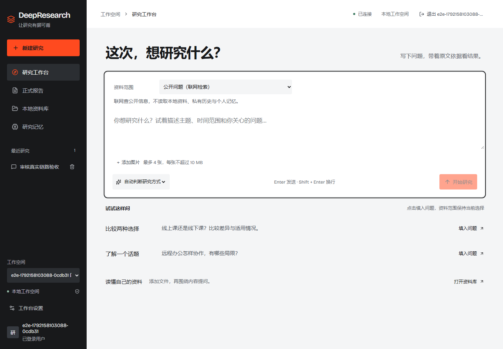
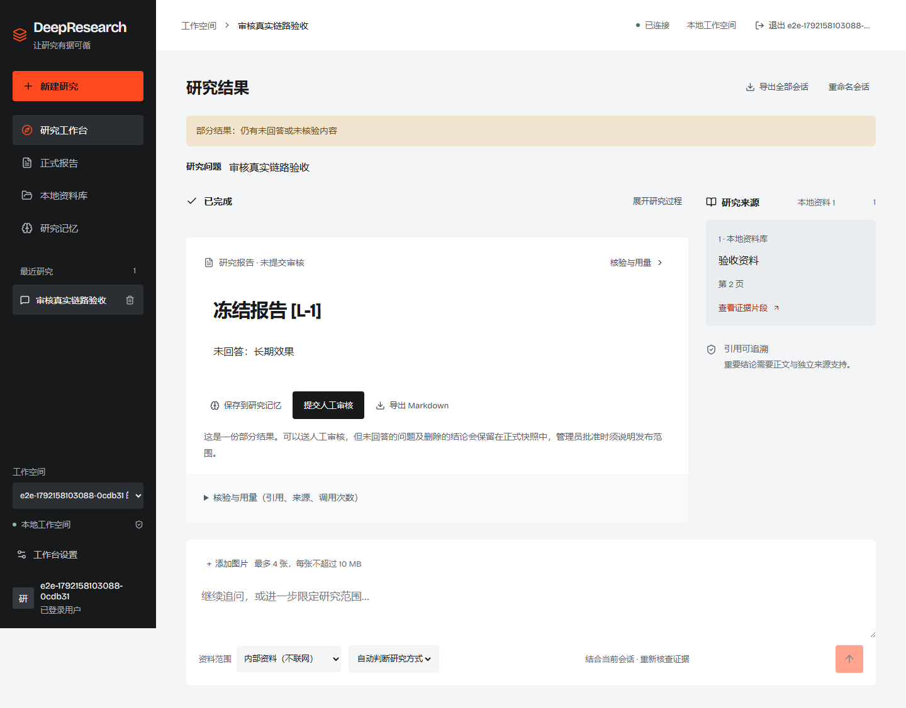
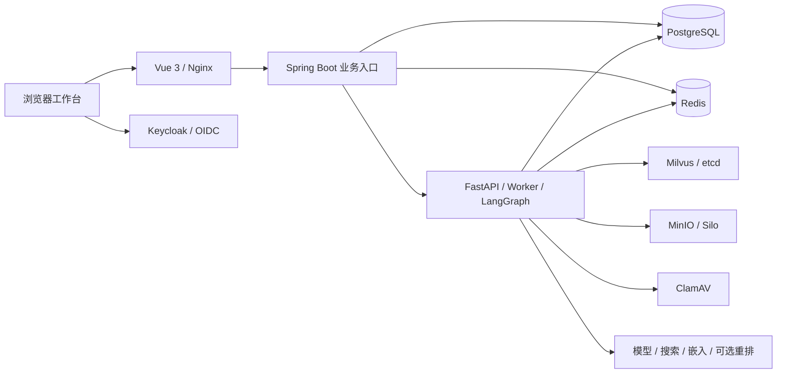

# DeepResearch 研究工作台

把研究问题、检索资料、原文引用和报告审核放在一个工作台中。输入问题后，从公开网页或有权限的内部资料查找依据，生成带引用的中文草稿；读者可以回看原文片段，由另一位管理员审核后发布冻结版本。

适合需要保留依据、反复追问和协作审阅的个人或小团队。Agent 负责规划、检索、分析和写作；身份权限、任务预算、资料授权与正式报告由业务系统管理。模型生成内容仍需人工判断，资料不足会显示部分结果和未回答问题。

- 部署：[选择启动方式](#选择启动方式) · [容器 Packages](docs/container-packages.md) · [源码启动](docs/source-release.md)。
- 理解项目：[架构与目录](#架构与目录) · [源码调用路径](docs/project-structure.md) · [Java／Python 职责](docs/java-python-ownership.md)。
- 维护：[贡献指南](CONTRIBUTING.md) · [升级与恢复](docs/deployment-security-operations.md) · [安全报告](SECURITY.md)。

## 可以做什么

| 场景 | 操作与可观察结果 |
| --- | --- |
| 公开研究 | 输入问题、确认范围，使用快速问答或深度研究；查看进度、正文、来源与原文，导出 Markdown 并继续追问 |
| 内部资料问答 | 上传 TXT、Markdown、DOCX、PDF 或图片，完成扫描、解析和索引；按资料权限检索，撤权同步影响历史访问 |
| 协作审核 | 作者送审，另一位管理员批准；冻结正文和证据，保留修订、驳回、撤回及审计记录 |
| 平台管理 | 管理空间、成员、账号停用与恢复、任务取消、用量和空间交接；旧会话撤销后须重新登录 |

内部资料模式关闭公开搜索，配置的模型服务仍会处理资料。使用前确认数据处理范围，按[资料与报告生命周期](docs/evidence-lifecycle.md)管理授权。单文件上限 10 MB，每轮最多 4 张图片；任务调用与 Token 预算由持久化账本约束。

## 界面与验证范围





[正式审核画面](docs/images/report-review.png)与[手机工作台](docs/images/workspace-mobile.png)展示同一类操作。以上是仓库已有的真实页面截图，使用固定展示资料和合成账号，**不是本轮新模型回答或新部署验收**；来源与重现入口见[素材说明](docs/images/README.md)。

`v0.1.3` 的三个应用镜像已公开并通过匿名拉取、完整身份与法律材料核验。隔离核心验收中，4 个浏览器用例通过、0 跳过，完成资料研究与引用检查，研究模型使用受控夹具。另复用 2026-11-10 从同一未变化 Agent 制品执行的 2 次官方 API 实测：合成文本 JSON 和 3072 维 Embedding，均成功、0 重试，原调用预算上限 1 USD；本次没有追加调用，也不将它们写成全面模型质量评估。

本机日常环境已使用实际拉取的制品完成普通端口、接口和运行源码验收：更新九个应用角色、Grafana 与两个 PostgreSQL 角色，其余十三个容器身份保持，14 张业务表摘要、持久化资源和原有保护配置保持一致，结束后恢复全部 25 个容器停止。隔离浏览器使用专用 Windows TCP relay，普通日常端口的结论来自单独的日常验收，不混作同一次验证。

此前真实 OpenAI 回答、公开研究、嵌入和重排的结果见[2026-11-08 日常验收](docs/evidence/daily-20261108/README.md)。组件、权限、故障恢复与混合负载的历史结果见[证据索引](docs/evidence/production-20261107/README.md)；不同阶段的夹具、供应商和部署证据分别解释。

## 架构与目录



Java 管理公开接口、权限、任务准入、Outbox 和正式报告。Python 执行研究图、资料解析、检索与引用验证，写入任务执行结果和检查点；前端显示活动进度、草稿与冻结报告。监控、日志和追踪按需启用，配置入口见[观测手册](docs/production-observability.md)。

| 路径 | 职责 |
| --- | --- |
| `business-backend/` | Java 业务控制面、权限、任务和审核 |
| `backend/` | Python 编排、检索、资料处理及 Worker |
| `frontend/` | Vue 工作台与前端测试 |
| `migrations/` | 数据库迁移与版本顺序 |
| `deployment/` | 编排、构建、第三方来源与安全证据 |
| `scripts/`、`tests/`、`eval/` | 维护工具、回归和评测 |

完整调用路径与本机文件边界见[源码导航](docs/project-structure.md)。云接入、多副本 Compose 和 Kubernetes 是部署入口；目标环境的 IAM、TLS、MFA／SMTP、告警和恢复仍需[部署后验收](docs/production-readiness.md#部署与发布验收)。

<a id="本地快速部署"></a>

## 选择启动方式

| 目的 | 来源与入口 | 需要的工具 |
| --- | --- | --- |
| 获取预构建应用镜像 | 公开 `v0.1.3`，三个 Packages 已实际匿名拉取并完成日常验收；[版本、digest 与步骤](docs/container-packages.md) | Git、Python 3.11+、Docker Linux/amd64、Compose v2 |
| 从固定源码构建 | 源码 Tag `v0.1.3`，工程提交 `78a19df9dfa6f072af6ebe40ff99cf164d0c4ff8`；[构建启动步骤](docs/source-release.md#克隆后启动) | 同上；Java／Node 由 Docker 构建 |
| 修改当前开发源码 | `main` + Python 容器热更新，或独立组件开发检查；[开发指南](CONTRIBUTING.md#开发环境) | 完整开发检查另需 Python／uv、JDK 21／Maven、Node.js 22／npm |

三个应用镜像不包含完整依赖栈。首次安装仍须获取固定 MinIO／Silo 镜像，并按仓库配方构建 PostgreSQL、Keycloak、Milvus 等依赖。支持的平台为 Linux/amd64；Windows 使用 Docker Desktop 的 Linux 容器，未声称 arm64 已验收。网络下载、外部账号和模型调用额度由使用者准备。

### 新安装的配置

从上表所选版本克隆后，在仓库根目录执行 `python scripts/local.py init`。它只在 `.env` 不存在时初始化，生成独立服务凭据；已有 `.env` 原样保留。不要将第一次安装的配置和项目名用于覆盖已有日常环境。

| 私密配置 | 用途 |
| --- | --- |
| `LLM_API_KEY` | 所配置模型服务的密钥，默认官方 OpenAI |
| `EMBEDDING_API_KEY` | 官方嵌入；新安装默认 `text-embedding-3-large`、3072 维 |
| `RERANKER_API_KEY` | 可选 SiliconFlow 重排；不用时设置 `RERANKER_ENABLED=false` |
| 初始化生成的数据库、存储、内部服务及管理端凭据 | 不同角色独立身份，不需重复填写同一密码 |
| `PLATFORM_OPERATOR_SUBJECTS` | 需要平台治理时填写 IdP 账号稳定 `sub`，多个值用逗号分隔 |

已有历史索引时保持原 `EMBEDDING_*`，端点、模型或维度变更先走[影子索引迁移](docs/production-readiness.md#历史索引迁移与回退)。公开模式使用公开来源；内部模式外发资料须显式设置 `ALLOW_INTERNAL_MODEL_PROCESSING=true`，并理解供应商处理范围。配置名与完整步骤集中在[启动说明](docs/source-release.md)。

### 启动后的第一条研究

1. 打开 `http://localhost:8080`，注册或登录业务账号，创建个人空间。Keycloak 管理台默认 `http://localhost:8180/admin`；管理台账号不代替业务账号。
2. 选择“公开问题（联网检索）”，输入一个范围明确的问题，开始研究。
3. 查看进度和报告，打开引用原文，核对局限，导出 Markdown；需要时追问。
4. 使用内部资料时先上传并等待扫描和索引完成，再选择“内部资料（不联网）”。
5. 需要协作时设置成员与资料授权，由作者送审、另一位管理员批准，查看正式冻结报告。

暂停使用所选路线的 `stop`，保留配置和数据卷。源码启动器默认为核心栈；完整观测栈启动／停止都加 `--observability`，Grafana 默认 `http://localhost:3000`。已有部署继续沿用自己的覆盖文件、端口和项目名，升级前核实[恢复条件](docs/deployment-security-operations.md#现有数据升级)，不要删卷或重建空库。

## 版本、镜像与安全状态

下表区分源码版本、分发配方与当前开发提交；纯文档或测试提交不会改变已发布镜像身份。

| 对象 | 固定来源 | 获取与对应材料 |
| --- | --- | --- |
| 正式 `v0.1.3` | 源码与分发提交 `78a19df9dfa6f072af6ebe40ff99cf164d0c4ff8` | [Release](https://github.com/W205614/DeepResearch/releases/tag/v0.1.3) · [CI：4 项成功](https://github.com/W205614/DeepResearch/actions/runs/42968387539) · [Security：22 项成功](https://github.com/W205614/DeepResearch/actions/runs/42968387608) · [Packages 发布成功](https://github.com/W205614/DeepResearch/actions/runs/42977626649) |
| 三个 `v0.1.3` Packages | Agent／Backend 保留已验收的 `v0.1.2` 完整 config、层与标签；Web 包含新的 libxslt 修复与法律材料 | [Agent](https://github.com/users/W205614/packages/container/package/deepresearch-agent) · [Backend](https://github.com/users/W205614/packages/container/package/deepresearch-backend) · [Web](https://github.com/users/W205614/packages/container/package/deepresearch-web) · [精确身份与来源](docs/container-packages.md) |
| 历史 `v0.1.2` | `488550ecb61e7f369dd4967c7fa35e4c64369e75`；正常公开源码与对应源码载体 | [Release](https://github.com/W205614/DeepResearch/releases/tag/v0.1.2)；其 Packages 作业在推送前被新告警阻断。74 个对应源码分片仍由 `v0.1.3` 引用，继续保留 |
| 历史源码 `v0.1.1` | `b2da9da7c390bd50944c2947afd1381613c37192` | [源码 Release](https://github.com/W205614/DeepResearch/releases/tag/v0.1.1) |
| 历史应用镜像 `v0.1.1` | 打包提交 `0005df53b742cdc2b79ef9196208cf0d00f8a0b8`；保留 `b8d1500` 的应用运行字节 | [版本页内的应用制品、许可与对应源码](https://github.com/W205614/DeepResearch/releases/tag/v0.1.1) · [旧 digest 表](docs/container-packages.md#历史-v011-公开制品) |
| 70 条源码告警修复 | `679f499f24d99a677b1c15d96fa664f36ecb21fb` | [CI](https://github.com/W205614/DeepResearch/actions/runs/42768644693) · [Security](https://github.com/W205614/DeepResearch/actions/runs/42768644680) · [逐项依据](docs/security-alert-review-20261110.md) |

2026-11-11 核对：默认分支 Code scanning 与 Secret scanning 活动项均为 0。原 70 条告警为 1 条实际 fixed、68 条有依据误报关闭、1 条维护补丁缓解；随后 6 条 Go 清单告警按真实编译图逐项关闭。本轮新增两条验收探针静态 IV 告警已通过随机密钥／nonce 实际修复，新扫描自动标记为 fixed，没有 dismiss。原始报告、失败和依据保留，无活动告警不等于零漏洞，详见[全级别复核](docs/application-security-status-20261110.md)。

正式 Agent 已更新官方 glibc，完整范围扫描仍保留 **3 HIGH、57 MEDIUM、23 LOW、5 UNKNOWN** 共 88 条原始记录。精确逐项门槛结合完整运行闭包、官方固定代码和当前调用路径，确认适用未解决及秘密发现为 0；默认 raw-zero 的失败也保留。Backend 与修复 libxslt 后的 Web 原始发现为 0。这些结论已对实际公开归档和匿名拉取制品核验，不能自动套用于旧镜像或任意新增插件。

Grafana 使用 `grafana-source-20261110` 本地源码构建入口，主程序、BusyBox、十三个原插件与完整文件清单均已核验；PostgreSQL 保持 17.11 及 gosu 字节，实际修复 Kerberos、libxslt、zlib。两者已完成本机运行验收，没有新增公开第三方镜像。正常历史版本及仍有输入、许可或对应源码职责的 `artifact-*` 保留，不移动公开 Tag、不覆盖镜像版本。新对应源码采用小补充包加固定旧源码分片的引用方式，不能只下载新包就称为自包含，详见[源码获取](docs/container-packages.md)。

## 开发、测试与排错

Python 使用 `uv.lock`，Java 使用 `business-backend/pom.xml`，前端使用 `frontend/package-lock.json`。按[贡献指南](CONTRIBUTING.md)运行相关检查，回归示例：

```powershell
uv run pytest -q tests/test_consistency.py
mvn -B test -f business-backend/pom.xml
npm test --prefix frontend -- --run
```

集成测试使用隔离依赖，真实供应商评测按独立预算和账本执行。当前分支的常规 CI 包括 Python、Java、前端、真实组件恢复演练与编排浏览器测试；跳过项不算通过，不用历史计数替代当前结果。

| 现象 | 先检查 |
| --- | --- |
| 配置缺失或 Docker 不可用 | 所选源码版本、Linux/amd64 Engine、`python scripts/local.py check` 的明确错误；`check` 不验证 API 密钥有效性 |
| 下载断流或摘要不符 | 保留失败文件和日志，检查官方获取路径；不修改预期摘要接受错误页面 |
| 网页未就绪 | 用所选路线的同一套 Compose 参数执行 `ps`／`logs`，查看身份、数据库、迁移和 Worker；不要切换项目误查日常实例 |
| 无法调用模型或检索 | 检查对应官方端点、凭据、额度和嵌入配置；不要把官方密钥发给旧代理 |

账号、上传、数据库与向量数据按[备份／升级手册](docs/deployment-security-operations.md)保留。已有恢复脚本不等于已经存在最新有效恢复点。更多文档：[登录](docs/local-keycloak-login.md) · [多模态](docs/multimodal.md) · [治理与验收](docs/production-readiness.md) · [交付历史](docs/delivery-history.md)。

## 许可证与参与

独立原创代码和文档采用 [MIT License](LICENSE)，Copyright (c) 2026 W205614。第三方代码、字体、模型、依赖和容器组件保留各自许可，见[第三方说明](THIRD_PARTY_NOTICES.md)。Grafana、Loki、Tempo 和 MinIO／Silo 涉及 AGPL，项目 MIT 不覆盖它们。问题与改进通过 [Issues](https://github.com/W205614/DeepResearch/issues)／[PR](https://github.com/W205614/DeepResearch/pulls)讨论；漏洞按[安全政策](SECURITY.md)私下报告。
