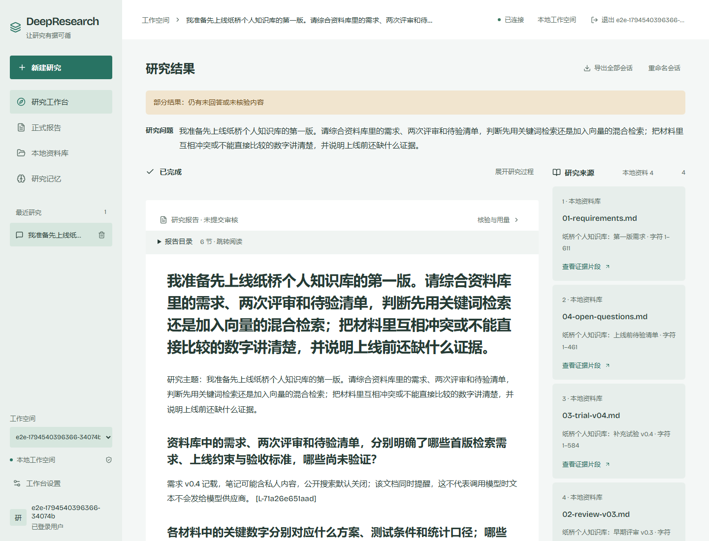
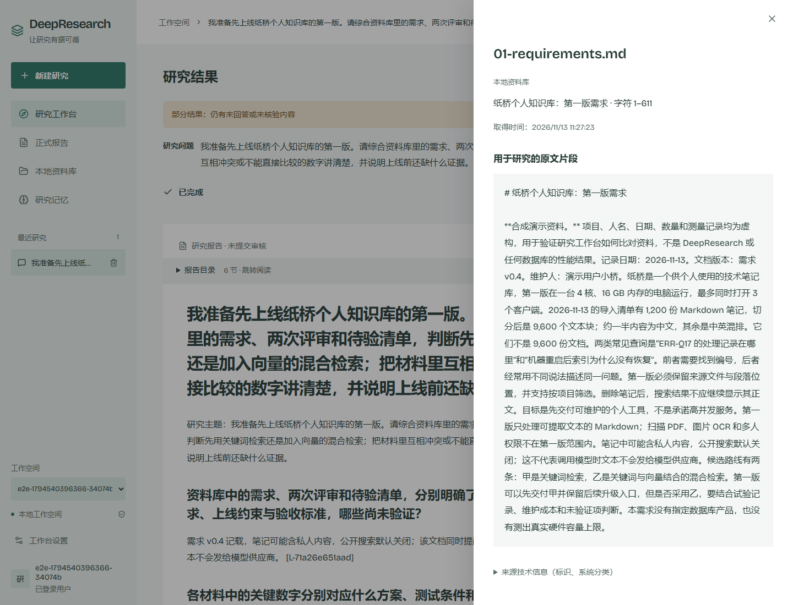

# 2026-11-13 真实流程复验

本页区分真实调用、失败、离线修复和发布；不是新版本发布证明。正式版本仍为 `v0.1.3`。以下三次研究使用工程提交 `89ba67b24b955a94015ff765fdb12b41e87052cc` 的真实 Agent，官方模型与嵌入端点，没有改写模型响应。MinIO 当时仍是 Go 修复后的旧 OS 候选，不能将这些结果当作后续原生库修补组合的验收。

| 实际研究 | 结果 | 边界 |
| --- | --- | --- |
| 原常规问法 `4dfb34e8…` | `completed`；2 条核验、2 条支持、0 删除；完整回答标记 true；浏览器 1 通过 | 报告质量仍为 `partial`，不能外推到全面研究质量 |
| 四资料方案评估 `f4878be2…` | `completed`，但仅支持 4/26 条、移除 22 条，完整回答标记 false；浏览器验收失败 | 明确归属于合成资料的若干自然表述被确定性解析误拦；后续离线修复不等于重新调用模型验收通过 |
| PostgreSQL／Milvus 联网比较 `4e82ce16…` | `failed`、0 来源，浏览器验收失败 | 搜索外层 20 秒超时取消了等待中的官方请求，未观察到 HTTP 结果；请求级等待配置为 120 秒 |

本地复杂案例的[四份输入](../../examples/paperbridge/README.md)是合成资料，数字和测量均为虚构。研究模型实际处理这些资料；这不使资料里的虚构性能数字成为真实测量。它要求区分文件和文本块、库存版本、不同查询集合、平均值和 P95，以及建议推进与批准上线。

可查阅[机器摘要](run-summary.json)、[常规完整结果](ordinary-result.json)、[复杂本地部分结果](local-partial-result.json)与[联网失败结果](network-failed-result.json)。旧问题、失败及原始结果保留，未换一个更容易的问题替代原验收。

## 页面截图

以下从已结束的 `f4878be2…` 真实运行只读打开，没有提交新研究、替换响应或注入报告。合成账号标识不是真实用户资料。截图保留“部分结果”提示，不作为完整回答通过证明。[截图收据](f487-capture-receipt.json)记录实际 run、报告和图片 SHA-256。

## 费用与停止点

截至上述联网失败，共 72 次外发请求，包含此前保留的 40 次；累计完整上界预留 **9.518317 USD / 10 USD**，剩余 **0.481683 USD**。这些是保守预留，不是供应商账单。第 72 次搜索的 HTTP 结果未知，保留其 **0.599728 USD** 预留；没有退款、删除或重置旧账本。

未知请求触发停止，剩余额度也不足预留一次同类联网搜索。后续付费复验尚未执行。真实费用账本和私密配置仅在本机保存，不作为公开附件。后来补充的 HTTP 头／完整正文诊断只用于未来观察，不能补造第 72 次请求的结果。

是否发布新版本，需要最终源码、实际镜像、MinIO／Backend 安全修补和最终真实组合复验共同满足发布要求。本页的旧组合结果不能替代它们。
