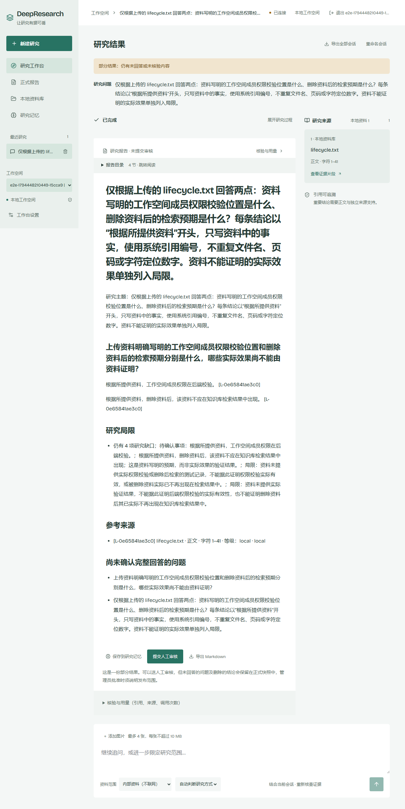

# 2026-11-12：v0.1.3 真实模型流程验收与发布整理

**整体结论为部分通过。** 当前正式镜像实际完成了真实模型研究链路；常规问法返回 `insufficient`，增加明确表达约束后的另一个场景完成浏览器检查，但报告仍标为 `partial`、`original_request_answered=false`。原失败没有改写成通过。远端发布整理已完成；另有 MinIO 新扫描记录阻断 Security，不能宣称当前全部验收通过。

## 真实运行对象和方法

源码 Tag 仍为 `v0.1.3`，工程/分发提交 `78a19df9dfa6f072af6ebe40ff99cf164d0c4ff8`。复用已匿名拉取并核验的同一 Linux/amd64 制品，实际运行 Engine ID 与下列正式 Registry digest 对应；没有重建、重推或替换任何已发布镜像。

| 组件 | 实际正式镜像 |
| --- | --- |
| Agent、研究 Worker、资料 Worker | `ghcr.io/w205614/deepresearch-agent@sha256:dd0ff5e0be21cf1ce7aed5f064752994d00dd2b11cb458e700372854e84d7c54` |
| Java 业务后端 | `ghcr.io/w205614/deepresearch-backend@sha256:c63727c9a3ecbce4b5d4964e6a483a4535798bfa190e0b0b72b932c451459149` |
| Web | `ghcr.io/w205614/deepresearch-web@sha256:013ba5daedc8d2d082f0b99ac88937781c8222c9321f28fdb8cd04ad253009e3` |

使用独立 Compose 项目、空业务库和独立 Milvus/对象存储，复用现有 `frontend/e2e/enterprise.e2e.ts` 的资料生命周期及权限检查。浏览器真实登录 Keycloak，从界面上传合成 TXT、选择内部资料并提交研究；经过 Java、Outbox、Python Worker、真实嵌入、Milvus 检索、研究图与引用核验，回到界面查看报告。随后检查资料删除后的搜索结果以及查看者写操作被拒绝。

模型为现有官方配置 `gpt-6.1-sol`、`reasoning_effort=low`；嵌入为官方 `text-embedding-3-large`、3072 维。最终直连 `https://api.openai.com/v1`；测试挂载的 HTTP 计费钩子仅记录和限制请求，不改写 URL、密钥、参数、模型结果或业务逻辑。没有加载 `component_fixture` 或模型/嵌入夹具。Windows 专用 loopback TCP relay 只传输浏览器到自建测试栈的字节，不冒充日常端口验收。

## 两个研究场景分别记录

| 场景 | 实际结果 | 不能扩大解释的边界 |
| --- | --- | --- |
| 常规问法：根据合成资料说明权限校验位置和删除后的检索预期 | `insufficient`；检查 2 条结论，支持 0、移除 2 | 模型将来源字符定位数字写进事实结论，数字检查拒绝；局部修订后又缺少门槛识别的资料归因措辞。不能宣称默认问法已经通过。 |
| 另一个有表达约束的问法：每条以“根据所提供资料”开头，仅用系统引用编号，定位数字不混入事实 | 浏览器 1 通过、0 失败/跳过/重试；研究 `completed`，2 条结论支持、0 移除 | 报告质量仍为 `partial`，`original_request_answered=false`，保留未回答问题和实际效果尚未证明的局限。不是全面模型质量通过。 |

后一个场景不是对前一个失败重判分：它有不同的实际用户输入和新供应商请求。没有放松数字、资料归因、来源权限或语义核验门槛。两者使用同一制品及同一累计费用账本，保留各自结果。

原始合成资料仅两句话：“功能验收资料：工作空间成员权限在后端校验。删除资料后，不应在知识库检索结果中出现。”本次未使用私人资料、重建历史索引或执行公开网络搜索；可选重排关闭。这是内部资料研究链路验收，不是生产容量、通用准确率或所有工具的验收。

## 外发、预算与失败保留

本次新授权累计上限 **5 USD**。共 23 次供应商 HTTP 尝试：11 次嵌入均 200；12 次模型请求中 11 次 200、1 次 400；没有未知 HTTP 结果。400 来自早期测试配置继承 `compatible` 后发送的 `max_tokens`，改回已有官方配置后保留原请求及其预留，不重置账本。

标准 Token 用量粗估为 0.04073344 USD，不代表账户账单或完整缓存写入计费；无用量的失败请求另保留 0.18824 USD 预留。所有请求按外发前完整上界累计预留 **2.373213 USD**，未超过 5 USD，没有靠清除旧记录释放本轮额度。价格核对来源：[官方文本模型计价](https://developers.openai.com/api/docs/pricing)、[官方嵌入计价](https://developers.openai.com/api/docs/models/text-embedding-3-large)。

测试搭建还保留 OIDC 地址/回调、启动收尾重叠、登录等待、官方端点保护及隔离索引指纹的失败。最终浏览器返回 0 后，外层 Windows 脚本用默认 GBK 读取 UTF-8 结果发生收尾错误，原外层摘要仍为 false；后续显式 UTF-8 读取原报告、浏览器 JSON 和账本导出本页证据，没有再发请求或改写原始浏览器结果。

## 发布入口与安全检查

原应用制品辅助 Release 已并入现有 [v0.1.1](https://github.com/W205614/DeepResearch/releases/tag/v0.1.1)，保留全部 88 个原 asset ID、摘要与字节；产品源码 Tag 不移动，分发来源仍单列为 `0005df53`。引用迁移推送并核对远端完整字节后，已删除旧辅助 Tag。实际远端由 10 组降为 **9 个 Tag、9 个 Release**，包括 4 个产品版本及 5 个有固定输入/来源职责的第三方例外，见[逐项保留依据](../../release-asset-retention-20261112.md)。

迁移提交 `e8b1e372a5b90d83ed282d6f5de4bc30ac2f8006` 的 [Security](https://github.com/W205614/DeepResearch/actions/runs/43134799699) 已结束：21 个 job 成功，1 个 MinIO job 失败。原始扫描在 `usr/bin/mcli` 和 `usr/bin/silo` 各新增 `stdlib v1.27.3 / CVE-2026-97054 / UNKNOWN`，超出既有精确门槛，失败为 `Additional, missing, duplicate or changed classified findings remain blocked`。这两条尚未完成适用性判断，不能假定无风险；未过滤、降级、dismiss 或放松门槛，也没有修改旧制品。

同日实际查询默认分支 Code scanning 和 Secret scanning 活动项均为 0；这不等于镜像门槛通过或零漏洞。最终推送提交的 CI 状态须查看对应提交检查，不借用旧的绿色结果。

## 收尾与材料

日常 25 个容器 ID、镜像、挂载及停止状态与基线一致，六份本机配置摘要保持，未查询或写入日常业务库，未启用自动备份。两套自建测试栈的容器和 TCP relay 进程已结束；测试卷、网络、失败记录和费用账本保留，不清理宿主文件。

- [脱敏验收数据及逐请求状态/摘要](acceptance.json)
- [常规问法的 insufficient 原结果](default-prompt-insufficient.json)
- [应用 Release 迁移与 88 个资产身份对照](application-release-relocation.json)
- [MinIO 新扫描记录及原始报告摘要](minio-scan-followup.json)

没有新增业务代码、容器版本或二进制发行；本次新增的是验证结果、发现的问题和已执行的发布入口整理。默认问法的结论组织/修订问题与 MinIO 新扫描适用性仍待后续处理，不能把受限场景成功写成全部发布验收完成。
